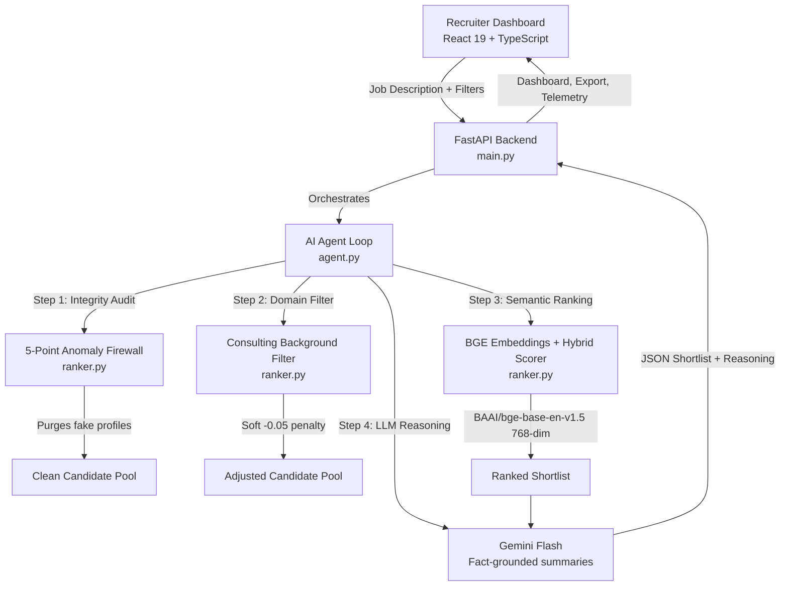

# RecruitShield AI — Autonomous Recruiter Intelligence and Verification Engine

RecruitShield AI is an intelligent candidate discovery, integrity auditing, and live employer verification platform. It ingests candidate data and produces a bias-free, fraud-scrubbed, semantically-ranked shortlist powered by an autonomous multi-agent loop, forensic verification rules, and live Google Knowledge Graph and Google Maps intelligence.

---

## Live Deployments

| Service | Target URL |
|---|---|
| Recruiter Dashboard (Vercel) | [https://recruit-shield-ai.vercel.app](https://recruit-shield-ai.vercel.app) |
| Backend API Service (Render) | [https://recruitshield-ai.onrender.com](https://recruitshield-ai.onrender.com) |
| Interactive API Documentation | [https://recruitshield-ai.onrender.com/docs](https://recruitshield-ai.onrender.com/docs) |
| System Health Check | [https://recruitshield-ai.onrender.com/health](https://recruitshield-ai.onrender.com/health) |

---

## What Problem Does It Solve?

Recruitment and talent acquisition pipelines encounter three critical bottlenecks:
1. Fraudulent and honeypot profiles: Fake resumes with fabricated timelines, exaggerated tenures, and non-existent company references that waste interviewer time.
2. Bias and noise in candidate shortlisting: Manual CV screening is slow and biased toward brand names rather than skill depth.
3. Lack of decision transparency: Black-box screening platforms fail to provide auditable justifications for why a candidate was shortlisted or rejected.

RecruitShield AI addresses these bottlenecks through:
- Automated fraud detection: Purging contradictory profiles using a rule-based 5-Point Anomaly Firewall.
- Semantic ranking: Scoring candidates through dense vector embeddings and multi-factor hybrid scoring.
- Factual reasoning summaries: Generating grounded recruiter insights for each candidate via LLM reasoning.
- Auditable execution telemetry: Offering a live agent telemetry console to inspect every verification event in real time.

---

## System Architecture



---

## Core Capabilities

### 1. 5-Point Anomaly Firewall
Detects honeypot and fraudulent resumes using deterministic integrity checks:
1. Signup date after last active date: Temporal impossibility indicating synthetic profile creation.
2. Skill duration exceeds total career experience: Candidate claims more years using a skill than total years in the workforce.
3. Expert skill claim with zero months practical usage: Contradictory proficiency declaration.
4. Job start prior to company founding year: Cross-references claimed employment start year against company formation dates.
5. Job duration exceeds company age: Flags claims where tenure exceeds the entire lifespan of the entity.

### 2. Hybrid Neural and Rule-Based Ranking
Shortlist ordering evaluates candidates across multiple weighted dimensions:
- Semantic Similarity (40% weight): 768-dimensional cosine similarity matching candidate experience against the job description using `BAAI/bge-base-en-v1.5`.
- Skill Overlap Score (25% weight): Depth, duration, and direct keyword match against required technical competencies.
- Title Alignment Score (20% weight): Hierarchical seniority and domain alignment to target role.
- Career History Relevance (10% weight): Match between previous project responsibilities and required qualifications.
- Availability Factor (5% weight): Notice period, responsiveness, and recency of profile activity.

### 3. Live Employer Verification (SerpApi)
RecruitShield AI integrates SerpApi as an automated web verification layer to audit candidate career claims in real time. By querying live Google Knowledge Graph corporate records and Google Maps branch geolocations, the anomaly firewall verifies whether claimed employers, founding years, and local office branches legitimately exist before candidates are shortlisted.

---

## Repository Structure

```
.
├── backend/
│   ├── main.py                     # FastAPI REST API application and endpoints
│   ├── agent.py                    # Autonomous screening agent and audit orchestration
│   ├── ranker.py                   # Scoring algorithms, 5-point firewall, and embeddings
│   ├── serp_client.py              # Search API client, call budgeting, and caching
│   ├── serp_verifier.py            # Live employer and branch verifications
│   ├── rank.py                     # Candidate ranking entrypoint
│   ├── embed_candidates.py         # Embedding generation pipeline
│   └── sample_candidates.jsonl     # Sample candidate profile dataset
│
├── frontend/
│   ├── src/
│   │   ├── App.tsx                 # Recruiter dashboard, candidate inspect drawer, chat
│   │   ├── index.css               # Design system and glassmorphism styling
│   │   └── components/             # Reusable interactive UI components
│   ├── package.json                # Frontend dependencies
│   ├── vite.config.ts              # Vite bundling configuration
│   └── vercel.json                 # Frontend deployment configuration
│
├── tests/
│   ├── test_rank_scoring.py        # Pytest test cases for ranking engine invariants
│   ├── test_honeypot_firewall.py   # Anomaly firewall test cases
│   ├── test_consulting_filter.py   # Consulting background penalty validation
│   └── test_serpapi_integration.py # Mocked tests for search verification layer
│
├── requirements.txt                # Python backend dependencies
├── Dockerfile                      # Backend container configuration
├── vercel.json                     # Root monorepo deployment routing configuration
└── README.md                       # Main documentation
```

---

## Setup and Local Development

### Prerequisites
- Python 3.9+
- Node.js 18+ and npm

### 1. Backend Setup

```bash
# Clone the repository
git clone https://github.com/Parth-kulkarni300/RecruitShield-AI.git
cd RecruitShield-AI

# Create and activate a virtual environment
python -m venv venv
# On Windows:
.\venv\Scripts\activate
# On Linux/macOS:
# source venv/bin/activate

# Install dependencies
pip install -r requirements.txt

# Start backend server
uvicorn backend.main:app --reload --port 8000
```

The API will be available at `http://localhost:8000` and Swagger docs at `http://localhost:8000/docs`.

### 2. Frontend Setup

```bash
# Navigate to the frontend directory
cd frontend

# Install dependencies
npm install

# Start the Vite development server
npm run dev
```

The dashboard will be accessible at `http://localhost:5173`.

### 3. Running Unit Tests

```bash
pytest tests/ -v
```
